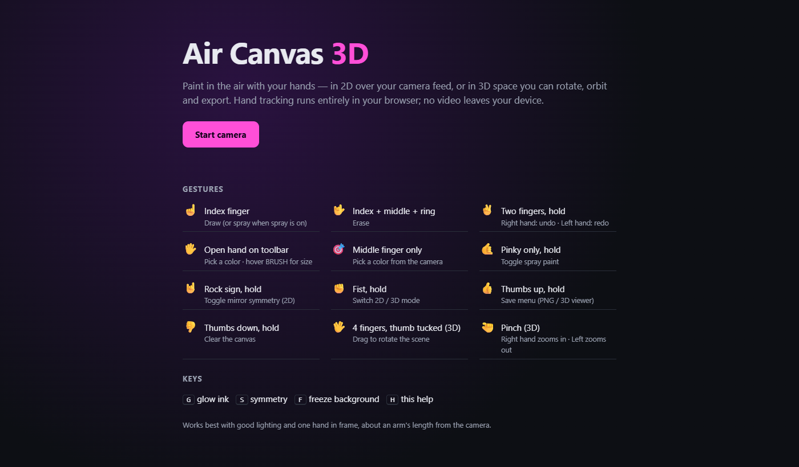
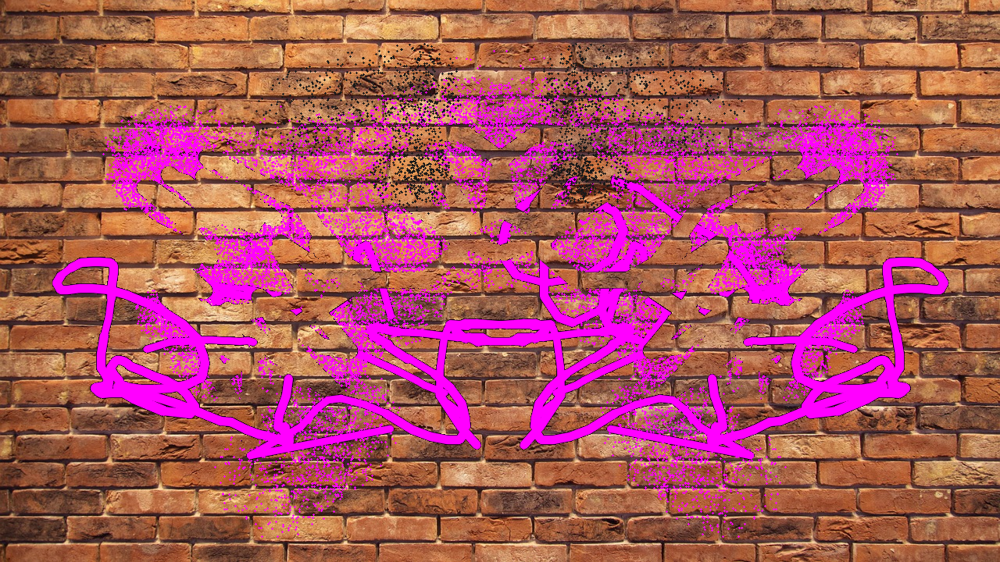
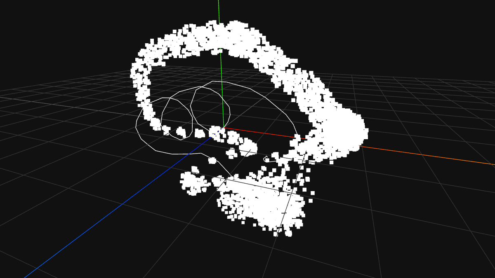

# Air Canvas 3D

Paint in the air with your hands. A webcam and real-time hand tracking turn finger gestures into brush strokes, either in 2D over the live camera feed or in a 3D space you can rotate, zoom, orbit and export as a 3D model.

**[Live demo →](https://air-canvas-3d.vercel.app)** · runs entirely in the browser, no video leaves your device



| 2D: spray + mirror symmetry on brick | 3D: a spray and line drawing, orbited in the viewer |
|---|---|
|  |  |

## Features

- **Gesture-only controls.** 12 hand gestures for drawing, erasing, undo/redo, color picking, spray, symmetry, saving and switching modes. No mouse or keyboard needed.
- **2D canvas.** Pressure-like brush width from hand depth, spray paint sized by hand distance, mirror symmetry, neon glow ink, and a color picker that samples the real world through the camera.
- **3D canvas.** Strokes get depth from how far your hand is from the camera. Rotate the scene with four fingers up (thumb tucked), pinch to zoom, and erase in screen space.
- **Export.** PNG on four backgrounds (raw, white, brick, white brick), a Wavefront `.obj` model, or a standalone Three.js viewer page.
- **Two hands.** Each hand is tracked separately; for example, right-hand two-finger means undo and left-hand means redo.

## Gestures

| Gesture | Action |
|---|---|
| ☝️ Index finger | Draw (spray when spray is on) |
| 🤟 Index + middle + ring | Erase |
| ✌️ Two fingers, hold | Undo (right hand) / redo (left hand) |
| 🖐️ Open hand over toolbar | Pick a color, adjust brush size |
| Middle finger only | Pick a color from the camera |
| 🤙 Pinky only, hold | Toggle spray |
| 🤘 Rock sign, hold | Toggle mirror symmetry (2D) |
| ✊ Fist, hold | Switch 2D / 3D |
| 👍 Thumbs up, hold | Save menu |
| 👎 Thumbs down, hold | Clear canvas |
| 🖖 Four fingers, thumb tucked | Rotate the 3D scene |
| 🤏 Pinch | Zoom in (right hand) / out (left hand) |

Keys: `G` glow ink, `S` symmetry, `F` freeze background, `H` help (web).

## How it works

1. **Hand tracking.** MediaPipe Hand Landmarker finds 21 landmarks per hand in every frame.
2. **Gesture classification.** Each finger is classed as *up* or *curled* by comparing fingertip and knuckle heights, normalized by palm size so it works at any distance. The thumb is checked by its distance from the index knuckle. A rule table maps those states to a gesture, and a 5-frame majority vote filters out flicker.
3. **Smoothing.** The cursor is an exponentially smoothed fingertip position. Holds (save, clear, undo) use timers with on-screen progress bars, so nothing fires by accident.
4. **2D.** Strokes are stored as segments, so undo/redo replays them onto two transparent layers (matte and glow). The eraser cuts through both layers.
5. **3D.** A fingertip's screen position and MediaPipe depth are un-projected through a perspective camera and the inverse of the current rotation into world space. Rendering projects them back, sorted far-to-near, with depth fading.

## Project structure

```
web/          Browser version (deployed): vanilla ES modules, no build step
  js/         gestures · canvas2d · scene3d · ui · export · app (main loop)
desktop/      Original Python desktop app (OpenCV + MediaPipe)
docs/         Project report and sample outputs
test_web.mjs  Tests for the web version (checks the 3D math against the Python version)
```

The web version is a port of the desktop app, one module per Python module, so the two read side by side.

## Run locally

**Web**: any static server works (the camera needs `localhost` or HTTPS):

```bash
cd web && python -m http.server 8000   # open http://localhost:8000
node test_web.mjs                      # tests
```

**Desktop**: Python 3.12:

```bash
cd desktop
python -m venv .venv && .venv/Scripts/activate   # macOS/Linux: source .venv/bin/activate
pip install -r requirements.txt
python main.py          # press q to quit
python test_core.py     # headless tests, no webcam needed
```

`mediapipe` is pinned to 0.10.21 because newer releases removed the `mp.solutions` API the desktop app uses.

## Tech stack

MediaPipe Hand Landmarker (WASM/GPU) · Canvas 2D · Three.js · vanilla JavaScript · Vercel. The desktop version uses Python, OpenCV, MediaPipe and NumPy.

## Credits

Built as a team project by **Raunak Kukreja** and **Sreesh Srikanth**. The original desktop version lives at [sreesh07/AIR_CANVAS_3D](https://github.com/sreesh07/AIR_CANVAS_3D). Its history is preserved here, and the browser port builds on it.
